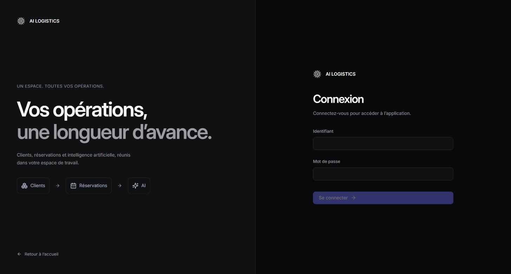
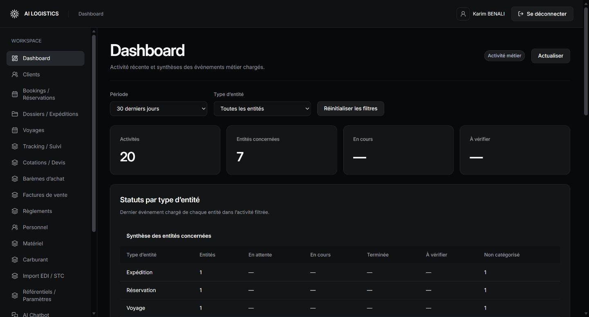
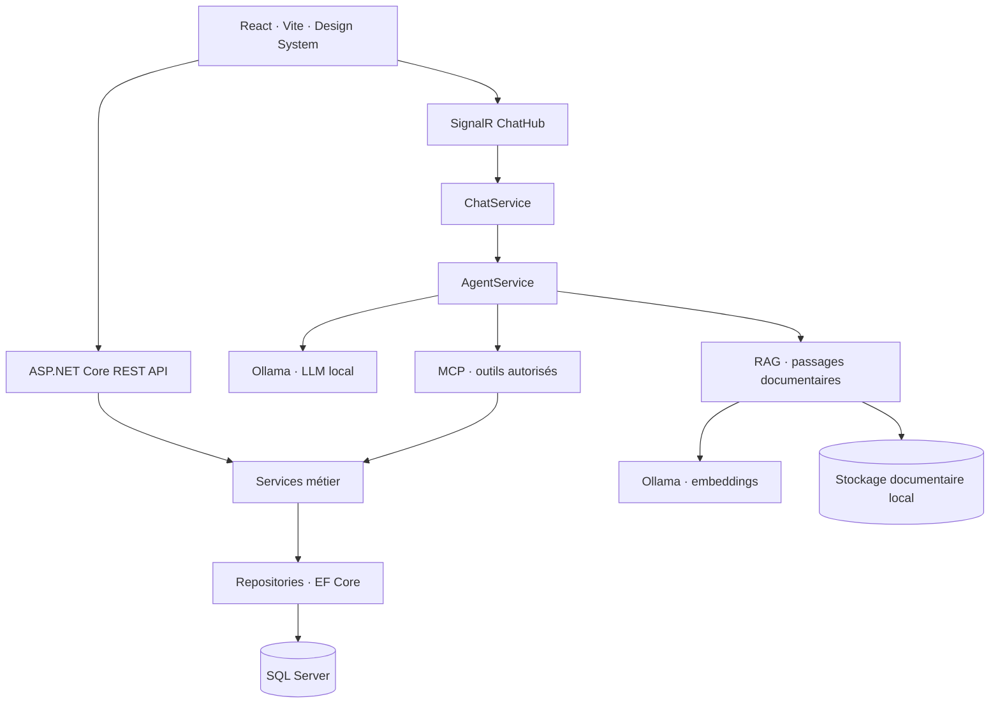

<div align="center">

# AI LOGISTICS PLATFORM

### Les opérations logistiques et l’IA locale dans un même espace.

Gestion métier · Suivi des opérations · Chatbot · Knowledge Base · MCP


[Aperçu](#aperçu) · [Fonctionnalités](#fonctionnalités) · [Architecture](#architecture) · [Installation](#installation) · [Tests](#tests)

</div>

## Présentation

**AI Logistics Platform** associe un frontend React à un backend ASP.NET Core pour centraliser les opérations d’une entreprise de transport. L’application réunit les données métier, leur chronologie et une assistance IA utilisant un modèle local via Ollama.

Le projet fait évoluer une application métier historique vers une architecture en couches. Le frontend réutilise un Design System sombre commun aux écrans, avec authentification, états de chargement, pagination et gestion des erreurs.

## Aperçu

### Connexion



### Dashboard



*Captures de l’application exécutée localement. Les synthèses du dashboard portent sur les événements chargés ; elles ne constituent pas un calcul de chiffre d’affaires ou de solde financier.*

## Fonctionnalités

| Domaine | Fonctionnalités principales |
| :--- | :--- |
| **Clients** | Recherche, validation, fiches, adresses et coordonnées bancaires. |
| **Bookings & expéditions** | Réservations, colisages, équipements, dossiers et associations aux voyages. |
| **Voyages & tracking** | Trajets, validation, clôture, réouverture et chronologie des événements. |
| **Cotations & barèmes** | Devis, prix, achats, grilles tarifaires et totaux. |
| **Facturation & règlements** | Factures, avoirs, exonération, paiements, affectations, remises et impayés. |
| **Ressources** | Personnel, matériel, coûts et opérations carburant. |
| **Import & référentiels** | Import EDI/STC, pays, devises, agences et paramètres métier. |
| **Compte utilisateur** | Connexion, session, routes protégées, identité et changement de mot de passe. |

### Assistance IA

- **Chatbot et streaming SignalR** : réception progressive des réponses, annulation et gestion de la connexion.
- **Knowledge Base / RAG** : import de PDF, DOCX, TXT, Markdown et CSV, extraction, indexation et recherche de passages avec sources.
- **MCP** : outils de lecture `GetClient`, `GetInvoice`, `GetShipment`, `GetTracking` et `GetBooking`, reposant sur les services métier.
- **Agent** : orchestration des sources documentaires et des outils métier. Les faits métier dynamiques doivent être confirmés par MCP.
- **Ollama local** : `qwen3:1.7b` pour la planification et `embeddinggemma:300m` pour les embeddings, selon la configuration livrée.

Les tools n’exposent pas d’exécution SQL arbitraire. Les passages RAG sont présentés comme des sources documentaires et ne remplacent pas la vérification des données métier courantes.

## Architecture



```text
ai-logistics-platform/
├── AI LOGTISTICS BACKEND/
│   ├── src/
│   │   ├── Logistics.Domain/          # Entités et règles métier
│   │   ├── Logistics.Application/     # Cas d’usage, contrats et orchestration IA
│   │   ├── Logistics.Infrastructure/  # EF Core, repositories, Ollama et RAG
│   │   └── Logistics.Api/             # Controllers, SignalR, MCP et authentification
│   ├── tests/                        # Tests unitaires et d’intégration
│   ├── Database/                     # Scripts de schéma et données de test
│   ├── Postman/                      # Contrats et collections API
│   └── docs/                         # Documentation technique
├── AI LOGISTICS FRONTEND/
│   ├── src/                          # Pages, services HTTP, hooks et composants
│   ├── tests/                        # Vitest et Testing Library
│   └── public/                       # Ressources statiques
└── docs/screenshots/                  # Captures utilisées dans ce README
```

*Les noms des deux dossiers d’origine, y compris « LOGTISTICS », sont conservés.*

## Installation

### Prérequis

- SDK **.NET 10**.
- **Node.js 20.19+ ou 22.12+** avec npm.
- **SQL Server** ou SQL Server Express LocalDB et, au besoin, SSMS/sqlcmd.
- **Ollama**, pour utiliser les fonctions IA.

### 1. Récupérer le projet

```bash
git clone https://github.com/Sabir-Dev12/ai-logistics-platform.git
cd ai-logistics-platform
```

### 2. Préparer une base locale

Les fichiers de données et sauvegardes personnelles ne sont pas versionnés. Pour une base de développement neuve, consulter le [guide base de données](AI%20LOGTISTICS%20BACKEND/Database/README.md) et exécuter dans cet ordre :

1. `Database/Scripts/Create-TestDatabase.sql` sur l’instance SQL.
2. `Database/Scripts/Create-Schema.sql` dans la base créée.
3. `Database/Scripts/Seed-TestData.sql` uniquement pour charger les données de démonstration.

Une base historique existante doit être vérifiée avant d’y appliquer les scripts. Les données de test ne sont pas des données de production.

### 3. Configurer et démarrer le backend

Les configurations publiées ne contiennent pas la clé de signature ni les identifiants du poste d’origine. Dans PowerShell :

```powershell
cd "AI LOGTISTICS BACKEND"
$env:ASPNETCORE_ENVIRONMENT = "Development"
$env:ConnectionStrings__LogisticsDatabase = "Server=(localdb)\MSSQLLocalDB;Database=LogisticsDb;Integrated Security=true;TrustServerCertificate=true"
$env:Authentication__SigningKey = [Convert]::ToBase64String([Security.Cryptography.RandomNumberGenerator]::GetBytes(48))
dotnet restore
dotnet run --project src/Logistics.Api --launch-profile http
```

Utiliser un utilisateur autorisé de la base pour se connecter. Le mécanisme de compte de service reste désactivé tant que ses identifiants ne sont pas configurés. Pour conserver une configuration personnelle, utiliser les variables d’environnement ou les secrets utilisateur .NET, sans les committer.

| Service local | Adresse |
| :--- | :--- |
| API backend | `http://localhost:5192` |
| Frontend | `http://localhost:5173` |
| Hub chatbot | `http://localhost:5192/hubs/chat` |
| Serveur MCP | `http://localhost:5192/mcp` |

### 4. Installer les modèles locaux

```bash
ollama pull qwen3:1.7b
ollama pull embeddinggemma:300m
```

Ollama doit être accessible à l’adresse configurée dans `AI:Ollama` (par défaut `http://127.0.0.1:11434/`). Indexation et recherche doivent utiliser le même modèle d’embeddings. Les besoins en mémoire et la vitesse dépendent du matériel.

### 5. Démarrer le frontend

Dans un second terminal :

```powershell
cd "AI LOGISTICS FRONTEND"
Copy-Item .env.example .env.local
npm ci
npm run dev
```

Ouvrir **http://localhost:5173**. Vite relaie `/api`, `/hubs/chat` et `/mcp` vers le backend configuré. Ne pas placer de token permanent dans une variable préfixée `VITE_`.

## Tests

### Backend

```powershell
cd "AI LOGTISTICS BACKEND"
dotnet build Logistics.slnx
dotnet test tests/Logistics.UnitTests
```

Un runner en processus est également fourni pour les environnements Windows où le lancement du testhost est restreint :

```powershell
dotnet run --project tests/Logistics.Verify -- --unit-tests-only
```

Utiliser ce flag pour les vérifications sans modification de base. Le runner lancé sans flag inclut des scénarios de base de données ; consulter son code avant utilisation.

### Frontend

```powershell
cd "AI LOGISTICS FRONTEND"
npm test
npm run build
```

Les tests couvrent notamment les services API, les états UI, les règles métier, les filtres, l’authentification et l’orchestration IA. Les tests fondés sur des fixtures ne constituent pas une validation de chaque opération sur une base réelle.

## Documentation

- [Backend](AI%20LOGTISTICS%20BACKEND/README.md) · [Frontend](AI%20LOGISTICS%20FRONTEND/README.md)
- [Chatbot, MCP et RAG](AI%20LOGTISTICS%20BACKEND/docs/Chatbot-MCP-RAG.md)
- [Knowledge Base](AI%20LOGTISTICS%20BACKEND/docs/Knowledge-Base-backend.md)
- [Ollama local](AI%20LOGTISTICS%20BACKEND/docs/Ollama-local.md)
- [Collection Postman](AI%20LOGTISTICS%20BACKEND/Postman/README.md)
- [Design System](AI%20LOGISTICS%20FRONTEND/DESIGN-SYSTEM.md)

## État du projet

Le projet est une plateforme de développement en évolution. Certaines rubriques ne disposent pas encore d’un endpoint de consultation complet ; l’interface indique les indisponibilités plutôt que d’inventer un historique. Les schémas issus de la migration doivent être confrontés à la base historique utilisée. Les secrets, documents RAG, modèles téléchargés et données locales restent hors du dépôt.

---

<div align="center">Conçu avec C#, React et une IA locale au service des opérations logistiques.</div>
